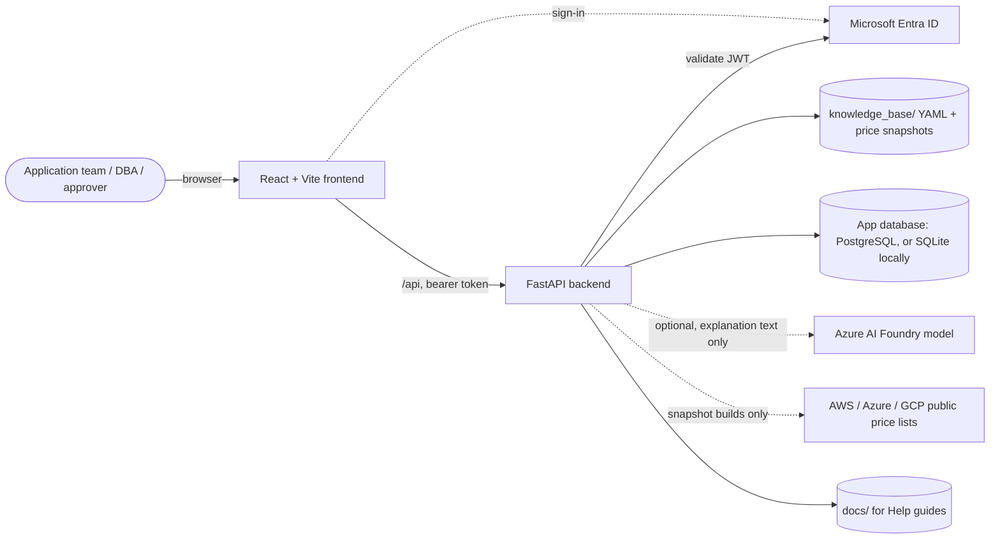
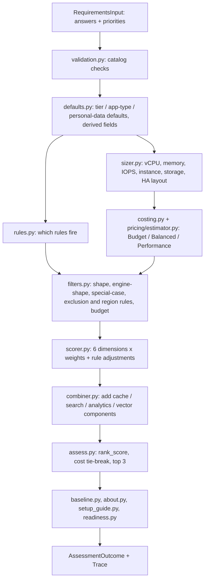
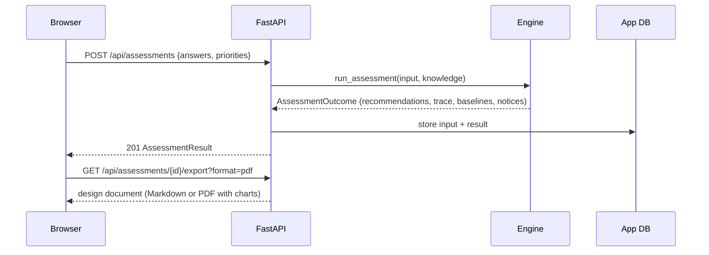
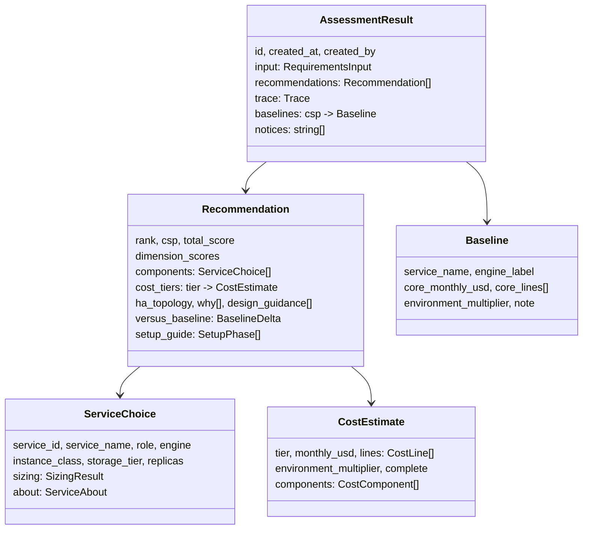

# DBCompass technical reference

For developers, DBAs who maintain the knowledge base, and reviewers. The plain-language version is
[10_HOW_RECOMMENDATIONS_WORK.md](10_HOW_RECOMMENDATIONS_WORK.md). Product scope and decisions live in
docs 01–09 and [OPEN_QUESTIONS.md](OPEN_QUESTIONS.md).

## 1. System overview



- **Frontend**: React 18, TypeScript, Tailwind, Recharts. It signs in with MSAL, or uses the dev bypass. It renders forms from the question catalog and results from the API.
- **Backend**: Python 3.11, FastAPI, Pydantic v2 and SQLAlchemy 2. It is stateless apart from the app database.
- **Knowledge base**: YAML files are the single source of truth for services, rules, prices, licences, migration tools, setup steps and help queries. They are loaded once and cached.
- **App database**: stores assessments, migration plans, requests, saved explanations and audit trails. It never holds application data.
- **LLM**: optional. It only rewrites a fact sheet built from the result, and every number and name is checked before display (`app/explain/grounding.py`).

## 2. Recommendation pipeline



Key properties:

- **Deterministic**: there is no randomness, clock or LLM in `run_assessment`. Ties are broken by Balanced monthly USD, then by service id.
- **Traced**: `Trace` holds the rules fired, every filtered-out service with its reason, assumed fields, dimension weights and every candidate's scores.
- **Weights**: the Performance, Cost and Reliability sliders share 0.70 in proportion to their positions. Ops, ecosystem and compliance are fixed at 0.10 each (`questions.yaml`). Portability is not scored.
- **Multi-engine services** (self-managed VMs): `scoring.yaml` `engine_shapes` limits which engine may run for a data shape. Survivors are narrowed to fitting engines before rules and scores run.

### Assessment request sequence



## 3. Repository layout

```
backend/app/
  api/          FastAPI routers (one file per area)
  auth/         Entra ID token validation and dev bypass
  db/           SQLAlchemy tables and read/write helpers
  engine/       the deterministic recommendation engine
  explain/      fact sheet, LLM writer, fact check, Q&A
  export/       design document outline + Markdown / PDF renderers
  justification/ licensed-engine justification gate
  knowledge/    YAML loader, catalog validation, knowledge base checker
  llm/          Azure OpenAI client (JSON mode only)
  migration/    migration planner: strategy, method, tools, runbook, risks
  models/       Pydantic models for every file, request and response
  pricing/      price snapshot builders and the estimator
backend/tests/  pytest suite (engine, pricing, migration, export, API)
frontend/src/
  api/          typed API clients
  auth/         MSAL provider
  components/   shared UI (cost tiers, charts, dropdowns, setup guide, plan view)
  pages/        Home, Intake, Results, MigrationPlan, Requests, History, Help
knowledge_base/ YAML catalog, rules, prices, licences, tools, setup guide, help queries
docs/           product, design and reference documents
```

## 4. API endpoints

All endpoints are under `/api` and need a bearer token, except `/api/health`. With
`DEV_AUTH_BYPASS=true` every call runs as a dev user. Roles come from Entra app roles:
`dba_admin` and `db_approver`.

| Method | Path | Returns | Purpose |
|---|---|---|---|
| GET | /health | HealthResponse | Liveness and database check (no auth) |
| GET | /me | CurrentUser | The signed-in user and roles |
| GET | /questions | QuestionSchema | Sections, questions and priority sliders for the forms |
| POST | /requirements/validate | ValidationReport | Check answers; preview defaults and weights |
| GET | /intake | IntakeConfig | Org support list, special cases, per-engine features and discovery queries, licensed engines |
| POST | /assessments | AssessmentResult (201) | Run the engine and store the result; 422 with a report when invalid |
| GET | /assessments | list[AssessmentSummary] | The caller's assessments, newest first |
| GET | /assessments/{id} | AssessmentResult | One stored assessment |
| POST | /assessments/{id}/whatif | WhatIfResult | Re-run with changed inputs (not stored; not shown in the UI since M10) |
| GET | /assessments/{id}/explanation | Explanation or null | Saved explanation |
| POST | /assessments/{id}/explanation | Explanation | Write one (fact-checked LLM text or rule-based) |
| POST | /assessments/{id}/ask | AnswerOut | Answer a question from the result's facts only |
| GET | /assessments/{id}/export?format=md\|pdf | file | Design document, PDF with score and cost charts |
| POST | /migrations/plan | MigrationPlan | Plan a migration from an assessment and/or answers |
| GET | /migrations/{id} | MigrationPlan | A stored plan |
| GET | /justification/reasons | JustificationConfig | Reasons and thresholds for the request form |
| POST | /justification/evaluate | JustificationEvaluation | Live verdict preview |
| POST | /requests | DbRequest | Create a draft request |
| PUT | /requests/{id} | DbRequest | Edit a draft or sent-back request |
| POST | /requests/{id}/submit | DbRequest | Send to approvers |
| POST | /requests/{id}/decision | DbRequest | Approve, reject or send back (db_approver) |
| GET | /requests?scope=mine\|review\|all | list | Requests |
| GET | /requests/{id} | DbRequest | One request with evaluation and audit trail |
| GET | /requests/{id}/export | Markdown | Justification packet |
| GET | /pricing/status | PricingStatus | Snapshot dates and coverage |
| POST | /pricing/refresh/{csp} | CspPricingStatus | Live Azure refresh (dba_admin) |
| GET | /help/guides | list[GuideSummary] | Help guides |
| GET | /help/guides/{slug} | Guide | One guide as Markdown |

The interactive OpenAPI page is at `http://localhost:8000/docs` while the backend runs.

## 5. Main models (backend/app/models)



## 6. Engine modules and key functions

| Module | Key functions | What they do |
|---|---|---|
| engine/assess.py | `run_assessment`, `find_candidates`, `build_all_combinations`, `rank_combinations`, `shape_notices` | Orchestrates the pipeline; ranks; warns about engine/shape conflicts |
| engine/defaults.py | `resolve_requirements`, `preview_defaults`, `derive_fields`, `licences_with_owned_answer` | Defaults from tier, app type and personal data; derived fields; "owned" licences count as BYOL |
| engine/rules.py | `fired_rules`, `condition_matches`, `all_predicates_match` | Rule grammar evaluation |
| engine/filters.py | `filter_services`, `shape_reason`, `engine_shape_reason`, `narrowed_to_shape`, `special_case_reason` | Hard filters, each removal with a reason |
| engine/sizer.py | `size_service`, `required_resources`, `chosen_engine`, `shape_fitting_engines` | Resources, instance, storage and HA layout; engine choice |
| engine/scorer.py | `score_all`, `score_service`, `score_performance`, `score_reliability`, `score_ops`, `score_ecosystem`, `score_compliance`, `score_cost` | Six dimensions, weighted score, rule adjustments |
| engine/weights.py | `compute_dimension_weights` | Sliders to weights |
| engine/combiner.py | `component_needs`, `build_combination` | Same-cloud add-on components |
| engine/costing.py | `service_estimate`, `recommendation_tiers`, `apply_budget_filter` | Tier sizing and prices with licences |
| engine/baseline.py | `build_baselines`, `baseline_for_csp`, `versus_baseline`, `core_lines` | Staying-on-the-same-engine price and the difference |
| engine/about.py | `service_about` | Managed vs self-managed explanation |
| engine/setup_guide.py | `build_setup_guide`, `guide_context`, `fill` | Setup steps for new applications |
| engine/readiness.py | `assess_readiness` | Team readiness for vendor applications |
| engine/naming.py | `engine_label`, `service_display_name` | "Oracle on Amazon EC2 + EBS (self-managed)" |
| pricing/estimator.py | `estimate`, `environment_multiplier` | Line-by-line monthly cost from snapshots |
| pricing/licensing.py | `licence_cost`, `owns_licences` | Oracle and SQL Server licence lines |
| migration/planner.py | `plan_migration`, `chosen_option`, `phases_for` | Strategy, method, tools, runbook, risks, rollback |
| export/document.py | `build_document` | One outline for Markdown and PDF |
| knowledge/check.py | `run_all_checks` | Cross-file consistency of the knowledge base |

### Price difference against staying (existing databases)

```
staying   = cheapest priced managed service on the same cloud running the current engine
            (a self-managed VM with licences when none is priced), same size and HA layout
core      = (compute lines + licence lines) x environment multiplier, Balanced tier
difference = option core - staying core      (negative = the option is cheaper)
```

Storage, backup and network are excluded: they cost about the same either way.

## 7. Knowledge base files

| File | Holds | Checked by |
|---|---|---|
| databases/*.yaml | One service each: engines, limits, SLA, features, regions, source_url, last_verified | `check_service_files` |
| questions.yaml | Question catalog, sliders, fixed weights, tier defaults | catalog model + `check_*` |
| rules.yaml | Filters, boosts, penalties, components, guidance | `check_rules` |
| scoring.yaml | Scoring tables, engine_shapes, combination settings | `check_scoring` |
| sizing.yaml, hardware_profiles.yaml | Sizing constants and instance ladders | `check_sizing`, `check_hardware` |
| pricing.yaml, price_snapshots/*.json | How to find prices; the prices found | `check_pricing_*` |
| licensing.yaml | Licence list prices and counting rules | `check_licensing` |
| org_support.yaml | Supported engines and special-purpose services | `check_catalog_against_support_list` |
| engine_features.yaml | Per-engine features with metadata queries, discovery queries (Help) | `check_intake` |
| migration_tools.yaml | Strategies, tools, phases, risks | `check_migration` |
| justification.yaml | Request reasons and thresholds | `check_justification` |
| service_models.yaml | Managed / serverless / self-managed explanations | `check_service_models` |
| setup_guide.yaml | Setup step templates and lookups | `check_setup_guide` |

Run the checker after every change:

```
cd backend && python -m app.knowledge.check
```

## 8. Frontend pages

| Route | Page | Main components |
|---|---|---|
| / | Home | Hero with the example engine run, features, how to use it |
| /assessments/new | Intake | StepFrame, ChoiceCards, Chips, PrioritySliders, expert survey |
| /assessments/:id | Results | Price difference card, recommendation cards (CostTiers, ScoreRadar, Disclosure), SetupGuide, WhyNotPanel, ExplanationPanel, ExportMenu |
| /migrations/new, /migrations/:id | Migration plan | TargetPicker, PlanView |
| /requests, /requests/new, /requests/:id | Requests | JustificationForm, VerdictPanel |
| /history | History | Past assessments |
| /help | Help | Guides; Databases > features > queries |

## 9. Security

- No application code or customer data is read or stored. Discovery and feature queries return metadata only, and teams run them themselves.
- Entra ID JWTs are validated on every call: issuer, audience and signature. Roles gate approvals and price refresh.
- Secrets come only from environment variables (`app/config.py`). `.env` is never committed.
- The LLM sees only the fact sheet. Its output is fact-checked, and on failure the rule-based text is used instead.

## 10. Extending

- **Add a service**: add `knowledge_base/databases/<csp>_<name>.yaml` with `source_url` and `last_verified`, then pricing in `pricing.yaml`. Run the snapshot build and the checker.
- **Add a rule**: add it to `rules.yaml` and a golden test case if it changes rankings.
- **Add a setup step**: add a template to `setup_guide.yaml`. Use only placeholders the checker knows.
- **Add a help query**: add it to `engine_features.yaml` under `discovery` or a feature's `how_to_check`.
- **Tests**: run `cd backend && pytest -q` and `cd frontend && npm run build`.
